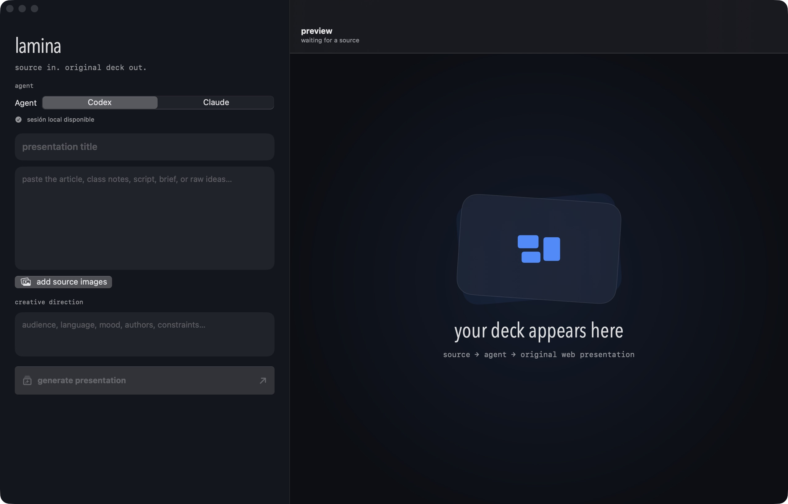

# lamina

native macos presentation engine that turns text and images into original, offline web decks using the ai agent the user already has connected.



## what it does

- accepts raw text, notes, briefs, scripts, and source images
- generates complete horizontal web presentations with codex or claude code
- forces a subject-specific visual language instead of a generic card template
- previews the generated deck inside the app
- keeps every deck portable: plain html, css, javascript, and local assets
- validates the output before displaying it
- stores presentations in `~/Documents/Lamina Presentations`
- offers a compact graph mode that plans slides locally before invoking the agent
- reuses subject-aware narrative algorithms instead of rebuilding every deck from zero

## requirements

- macos 15 or newer
- swift 6.2 or newer to build from source
- either the codex cli or claude code cli installed and authenticated

lamina does not store api keys or account tokens. each provider keeps control of its own authentication, subscription, models, and usage limits.

## build

```bash
swift test
./scripts/package-app.sh
open build/Lamina.app
```

the packaging script builds a signed local `.app` bundle and generates the macos `.icns` file from the source svg.

## generation boundary

codex runs with a writable sandbox limited to the new presentation directory. claude code receives the same directory and only the read, write, and edit tools. personal codex rules, hooks, plugins, and mcp servers are not inherited during generation.

the generated deck must:

- work directly from `file://`
- contain no remote scripts, fonts, analytics, or cdn dependencies
- support keyboard, wheel, trackpad, click, and fullscreen controls
- respect reduced motion and visible keyboard focus
- avoid clipping at common desktop and narrow viewport sizes

## graph generation

graph mode is the default token-efficient path. lamina selects a reusable algorithm from the source, writes a compact slide graph, and asks the connected agent to execute that plan. the original source is stored once in the generated project's `planning/` directory instead of being repeated inside the agent prompt.

the built-in algorithm library lives in `Sources/Lamina/Resources/Algorithms/`:

- `narrative-arc` for stories, history, people, and cultural change
- `comparison` for versus decks and direct contrasts
- `process-explainer` for recipes, workflows, and transformations
- `concept-map` for systems, architecture, and connected ideas

each algorithm is plain json. it defines trigger keywords, slide roles, proven visual mechanisms, and constraints, so new patterns can be added without changing the generator.

## project structure

```text
Sources/Lamina/
├── App/                 app entry point and root layout
├── Design/              visual tokens
├── Features/Composer/   source editor and generation state
├── Features/Preview/    local web deck preview
├── Models/              requests, projects, providers, and errors
├── Resources/Algorithms reusable presentation behaviors
└── Services/            agents, process isolation, prompt, and validation
```

## status

early public build. the core flow, local preview, packaging, and output validation are implemented. provider availability and generation quality still depend on the locally installed cli and the user's plan.

## license

mit
